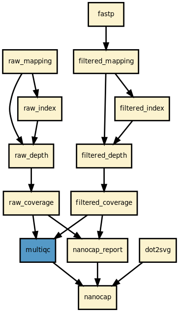

This is is the **nanocap** pipeline from the `Sequana <https://sequana.readthedocs.org>`_ project

.. image:: https://badge.fury.io/py/sequana-nanocap.svg
     :target: https://pypi.python.org/pypi/sequana_nanocap

.. image:: https://github.com/sequana/nanocap/actions/workflows/main.yml/badge.svg
   :target: https://github.com/sequana/nanocap/actions/

.. image:: https://img.shields.io/badge/python-3.8%20%7C%203.9%20%7C3.10-blue.svg
    :target: https://pypi.python.org/pypi/sequana
    :alt: Python 3.8 | 3.9 | 3.10

.. image:: http://joss.theoj.org/papers/10.21105/joss.00352/status.svg
   :target: http://joss.theoj.org/papers/10.21105/joss.00352
   :alt: JOSS (journal of open source software) DOI

:Overview: Adaptive sampling from nanopore quality control
:Input: A set of fastq file.
:Output: HTML reports to assess adaptive sampling experiment.
:Status: draft
:Citation: Cokelaer et al, (2017), ‘Sequana’: a Set of Snakemake NGS pipelines, Journal of Open Source Software, 2(16), 352, JOSS DOI doi:10.21105/joss.00352

Installation
~~~~~~~~~~~~

If you already have all requirements, you can install the packages using pip::

    pip install sequana_nanocap --upgrade

Usage
~~~~~

::

    sequana_nanocap --help
    sequana_nanocap --input-directory DATAPATH  --reference-file test.fa

This creates a directory with the pipeline and configuration file. You will then need 
to execute the pipeline::

    cd nanocap
    sh nanocap.sh  # for a local run

This launch a snakemake pipeline. If you are familiar with snakemake, you can 
retrieve the pipeline itself and its configuration files and then execute the pipeline yourself with specific parameters::

    snakemake -s nanocap.smk -c config.yml --cores 4 --stats stats.txt

Or use `sequanix <https://sequana.readthedocs.io/en/master/sequanix.html>`_ interface.

Requirements
~~~~~~~~~~~~

This pipelines requires the following executable(s):

- fastp
- minimap2
- samtools
- sequana
- multiqc (installed with sequana)

Details
~~~~~~~~~

This pipeline runs nanocap in parallel on the input fastq files (paired or not). A brief sequana summary report is also produced.

Rules and configuration details
~~~~~~~~~~~~~~~~~~~~~~~~~~~~~~~

Here is the `latest documented configuration file <https://raw.githubusercontent.com/sequana/nanocap/master/sequana_pipelines/nanocap/config.yaml>`_
to be used with the pipeline. Each rule used in the pipeline may have a section in the configuration file. 

Changelog
~~~~~~~~~

========= ====================================================================
Version   Description
========= ====================================================================
0.3.0     * refactoring to use click
0.2.0     * add containers
          * Fix tests adding the missing index
          * add workflow for apptainer
0.1.0     **First release.**
========= ====================================================================

